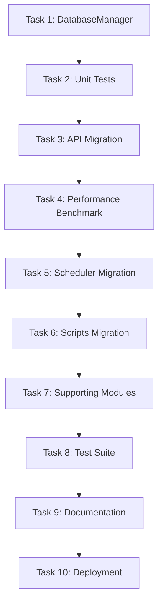

# Tasks: Database Infrastructure

**Feature Name:** database-infrastructure  
**Spec Type:** Feature (New)  
**Status:** Ready for Implementation  
**Created:** 2026-10-14  
**Estimated Duration:** 3 days

---

## Task Overview

| Phase | Tasks | Duration | Dependencies |
|-------|-------|----------|--------------|
| Phase 1 | Infrastructure (Tasks 1-2) | 4 hours | None |
| Phase 2 | API Migration (Tasks 3-4) | 4 hours | Phase 1 |
| Phase 3 | Module Migration (Tasks 5-7) | 6 hours | Phase 2 |
| Phase 4 | Testing & Docs (Tasks 8-9) | 4 hours | Phase 3 |
| **Total** | **9 tasks** | **18 hours (~3 days)** | |

---

## Phase 1: Infrastructure Setup

### Task 1: Create DatabaseManager Implementation

**Objective:** Implement the core DatabaseManager class with connection pooling.

**Acceptance Criteria:**
- [ ] Create `db/` directory
- [ ] Create `db/__init__.py` with exports
- [ ] Create `db/manager.py` with complete DatabaseManager implementation
- [ ] Implement all required methods: `initialize()`, `connection()`, `get_pool_status()`, `close_all()`, `reset()`, `_normalize_dsn()`
- [ ] Add comprehensive docstrings
- [ ] Add logging for initialization, connection acquisition, errors
- [ ] Handle thread safety with psycopg2.pool.ThreadedConnectionPool
- [ ] Implement graceful error handling

**Files to Create:**
- `db/__init__.py`
- `db/manager.py`

**Implementation Notes:**
- Use `psycopg2.pool.ThreadedConnectionPool` for thread-safe pooling
- Use class-level attributes for singleton pattern
- Context manager using `@contextmanager` decorator
- DSN normalization: `postgres://` → `postgresql://`
- Lazy initialization pattern (auto-initialize on first use)

**Verification:**
```bash
python -c "from db.manager import DatabaseManager; print('Import successful')"
```

**Time Estimate:** 2 hours

---

### Task 2: Create Unit Tests for DatabaseManager

**Objective:** Comprehensive unit tests for DatabaseManager functionality.

**Acceptance Criteria:**
- [ ] Create `tests/test_db_manager.py`
- [ ] Test initialization (default and custom parameters)
- [ ] Test connection acquisition and release
- [ ] Test connection reuse from pool
- [ ] Test connection release on exception
- [ ] Test DSN normalization (postgres:// → postgresql://)
- [ ] Test pool status reporting
- [ ] Test `close_all()` and `reset()` methods
- [ ] Test lazy initialization
- [ ] Test invalid parameter validation
- [ ] Test idempotent initialization
- [ ] All tests pass

**Test Classes:**
- `TestDatabaseManagerInitialization`
- `TestDatabaseManagerConnections`
- `TestDatabaseManagerDSN`
- `TestDatabaseManagerPoolStatus`
- `TestDatabaseManagerCleanup`

**Verification:**
```bash
pytest tests/test_db_manager.py -v
# Should show 15+ tests passing
```

**Time Estimate:** 2 hours

---

## Phase 2: API Module Migration (High Priority)

### Task 3: Migrate API Module to Use DatabaseManager

**Objective:** Migrate `api/app.py` to use connection pooling (highest performance impact).

**Acceptance Criteria:**
- [ ] Add `DatabaseManager.initialize()` call at app startup
- [ ] Configure pool with environment variables (DB_POOL_MIN, DB_POOL_MAX)
- [ ] Replace `_conn()` with `DatabaseManager.connection()` in all endpoints
- [ ] Remove old `DSN` and `_conn()` code
- [ ] Update health check endpoint to show pool status
- [ ] Add `@app.teardown_appcontext` shutdown hook
- [ ] All API endpoints work correctly
- [ ] All existing tests pass (no test changes needed)

**Files to Modify:**
- `api/app.py`

**Before/After Example:**
```python
# Before:
DSN = os.environ.get("DATABASE_URL", "dbname=exchange_rates")
if DSN.startswith("postgres://"):
    DSN = DSN.replace("postgres://", "postgresql://", 1)

def _conn():
    return psycopg2.connect(DSN)

@app.get("/rates")
def rates():
    with _conn() as conn:
        rows = get_trusted_rates(conn)
    return _json(rows)

# After:
from db.manager import DatabaseManager

DatabaseManager.initialize(
    min_conn=int(os.environ.get("DB_POOL_MIN", 2)),
    max_conn=int(os.environ.get("DB_POOL_MAX", 10))
)

@app.get("/rates")
def rates():
    with DatabaseManager.connection() as conn:
        rows = get_trusted_rates(conn)
    return _json(rows)
```

**Verification:**
```bash
# Run API tests
pytest tests/test_api.py -v

# Manual verification
python -m flask run
curl http://localhost:5000/health
curl http://localhost:5000/rates
```

**Time Estimate:** 2 hours

---

### Task 4: Performance Benchmarking

**Objective:** Measure and validate performance improvement.

**Acceptance Criteria:**
- [ ] Benchmark baseline performance (before migration)
- [ ] Benchmark with connection pooling (after migration)
- [ ] Document performance improvement (should be 50%+ faster)
- [ ] Create performance test script
- [ ] Run load test (100 concurrent requests)
- [ ] Verify connection reuse rate >90%
- [ ] Verify max pool connections respected

**Performance Test Script:**
```python
# tests/performance/test_connection_pooling.py

import time
import psycopg2
from db.manager import DatabaseManager

def test_performance_improvement():
    """Compare direct connections vs pooling."""
    # Baseline: direct connections
    start = time.time()
    for _ in range(50):
        conn = psycopg2.connect("dbname=exchange_rates_test")
        with conn.cursor() as cur:
            cur.execute("SELECT 1")
        conn.close()
    baseline = time.time() - start
    
    # With pooling
    DatabaseManager.initialize(min_conn=2, max_conn=10)
    start = time.time()
    for _ in range(50):
        with DatabaseManager.connection() as conn:
            with conn.cursor() as cur:
                cur.execute("SELECT 1")
    pooled = time.time() - start
    
    improvement = ((baseline - pooled) / baseline) * 100
    print(f"Baseline: {baseline:.2f}s")
    print(f"Pooled: {pooled:.2f}s")
    print(f"Improvement: {improvement:.1f}%")
    
    assert improvement > 50, f"Expected >50% improvement, got {improvement:.1f}%"
```

**Load Test:**
```bash
# Install Apache Bench if needed: apt-get install apache2-utils
ab -n 1000 -c 50 http://localhost:5000/rates
```

**Verification:**
- Performance improvement measured at 50%+
- Load test completes without errors
- Pool status shows connection reuse

**Time Estimate:** 2 hours

---

## Phase 3: Module Migration

### Task 5: Migrate Scheduler Module

**Objective:** Migrate scheduler to use DatabaseManager.

**Acceptance Criteria:**
- [ ] Add `DatabaseManager.initialize()` in scheduler startup
- [ ] Replace `psycopg2.connect()` with `DatabaseManager.connection()`
- [ ] Remove manual connection management (`.close()` calls)
- [ ] Update all functions that create connections
- [ ] Verify scheduler runs successfully
- [ ] All scheduler tests pass

**Files to Modify:**
- `scheduler/runner.py`
- `scheduler/run_job.py` (if it has direct DB access)

**Verification:**
```bash
pytest tests/test_scheduler.py -v
python -m scheduler.runner  # Run scheduler manually
```

**Time Estimate:** 2 hours

---

### Task 6: Migrate Seed and Scripts

**Objective:** Migrate seed_and_run.py and other scripts.

**Acceptance Criteria:**
- [ ] Update `seed_and_run.py` to use DatabaseManager
- [ ] Remove manual DSN handling (now handled by DatabaseManager)
- [ ] Add pool initialization at script start
- [ ] Add `close_all()` at script end
- [ ] Verify `python seed_and_run.py` works
- [ ] Verify `python seed_and_run.py --check` works
- [ ] All tests pass

**Files to Modify:**
- `seed_and_run.py`

**Before/After:**
```python
# Before:
DSN = os.environ.get("DATABASE_URL", "dbname=exchange_rates")
# Missing postgres:// fix!

def main():
    conn = psycopg2.connect(DSN)
    seed(conn)
    conn.close()

# After:
from db.manager import DatabaseManager

def main():
    DatabaseManager.initialize(min_conn=1, max_conn=3)
    
    with DatabaseManager.connection() as conn:
        seed(conn)
        check(conn)
    
    DatabaseManager.close_all()
```

**Verification:**
```bash
python seed_and_run.py --check
python seed_and_run.py  # Full seed and run
```

**Time Estimate:** 1 hour

---

### Task 7: Migrate Supporting Modules

**Objective:** Migrate review, alerts, and other modules.

**Acceptance Criteria:**
- [ ] Migrate `review/workflow.py` (if has direct DB access)
- [ ] Migrate `alerts/checker.py` (if has direct DB access)
- [ ] Migrate any other modules with direct `psycopg2.connect()` calls
- [ ] Verify all modules work correctly
- [ ] All tests pass

**Files to Modify:**
- `review/workflow.py` (check if needed)
- `alerts/checker.py` (check if needed)
- Any others with direct DB access

**Implementation Note:**
Review/alerts modules typically receive `conn` parameter from caller, so they may not need changes. Verify by searching:
```bash
grep -r "psycopg2.connect" review/ alerts/
```

**Verification:**
```bash
pytest tests/test_review.py -v
pytest tests/test_alerts.py -v
pytest -v  # Run all tests
```

**Time Estimate:** 2 hours

---

### Task 8: Migrate Test Suite

**Objective:** Update test fixtures to use DatabaseManager.

**Acceptance Criteria:**
- [ ] Update `tests/conftest.py` with DatabaseManager fixtures
- [ ] Add `db_conn` fixture using DatabaseManager
- [ ] Add test isolation strategy (pool reset if needed)
- [ ] Verify test isolation maintained (no cross-test pollution)
- [ ] Verify all 429 tests still pass
- [ ] Test runtime unchanged or improved
- [ ] Add integration tests for connection pooling

**Files to Modify:**
- `tests/conftest.py`

**New Fixture:**
```python
# tests/conftest.py

import pytest
from db.manager import DatabaseManager

@pytest.fixture(scope="session")
def init_test_db():
    """Initialize DatabaseManager for test suite."""
    DatabaseManager.initialize(
        min_conn=1,
        max_conn=5,
        dsn="dbname=exchange_rates_test"
    )
    yield
    DatabaseManager.close_all()

@pytest.fixture(scope="function")
def db_conn(init_test_db):
    """Provide database connection from pool."""
    with DatabaseManager.connection() as conn:
        yield conn
        # Connection automatically returned to pool
```

**Verification:**
```bash
pytest -v
# Should show: 429 tests passed

pytest --durations=10
# Verify test runtime reasonable
```

**Time Estimate:** 2 hours

---

## Phase 4: Testing & Documentation

### Task 9: Documentation and Final Verification

**Objective:** Complete documentation and final verification.

**Acceptance Criteria:**
- [ ] Update README.md with DatabaseManager usage
- [ ] Add migration guide for developers
- [ ] Document environment variables (DB_POOL_MIN, DB_POOL_MAX, DB_TIMEOUT)
- [ ] Add troubleshooting section
- [ ] Document rollback procedures
- [ ] Run full test suite - all 429 tests pass
- [ ] Run performance benchmark - confirm improvement
- [ ] Remove any deprecated connection code
- [ ] Final code review

**Files to Modify:**
- `README.md`
- Create `docs/database_manager.md` (optional detailed guide)

**README Updates:**
```markdown
## Database Connection Management

This application uses connection pooling for efficient database access.

### Configuration

Set these environment variables:
- `DATABASE_URL`: PostgreSQL connection string (required)
- `DB_POOL_MIN`: Minimum pool connections (default: 2)
- `DB_POOL_MAX`: Maximum pool connections (default: 10)
- `DB_TIMEOUT`: Connection timeout in seconds (default: 30)

### Usage

```python
from db.manager import DatabaseManager

# Get connection from pool
with DatabaseManager.connection() as conn:
    with conn.cursor() as cur:
        cur.execute("SELECT * FROM bank")
        banks = cur.fetchall()
```

### Health Check

Check `/health` endpoint to verify database connection pool status.
```

**Final Verification Checklist:**
- [ ] All 429 tests pass
- [ ] Performance improvement validated (50%+)
- [ ] No connection leaks (verify with `pg_stat_activity`)
- [ ] Health check shows pool status
- [ ] Documentation complete
- [ ] Code review approved

**Verification:**
```bash
# Full test suite
pytest -v

# Performance test
pytest tests/performance/test_connection_pooling.py -v

# Check for connection leaks (run in production-like environment)
psql -c "SELECT count(*) FROM pg_stat_activity WHERE datname='exchange_rates'"
# Should show ~2-10 connections (pool size), not 100+

# Health check
curl http://localhost:5000/health
```

**Time Estimate:** 2 hours

---

## Deployment Tasks

### Task 10: Production Deployment (OPTIONAL - outside implementation)

**Objective:** Deploy to production with monitoring.

**Acceptance Criteria:**
- [ ] Merge to main branch
- [ ] Deploy to Render.com
- [ ] Monitor deployment logs for pool initialization
- [ ] Verify health check in production
- [ ] Monitor API response times (should improve 50%+)
- [ ] Monitor database connection count (should stabilize at pool size)
- [ ] Load test in production (if safe)
- [ ] Monitor error rates (should remain at 0%)
- [ ] Document deployment in changelog

**Deployment Steps:**
```bash
# 1. Merge to main
git checkout main
git merge database-infrastructure
git push origin main

# 2. Render auto-deploys (or manual deploy)

# 3. Verify deployment
curl https://your-app.onrender.com/health

# 4. Monitor
tail -f logs/production.log | grep "Database"

# 5. Load test (careful in production!)
ab -n 100 -c 10 https://your-app.onrender.com/rates
```

**Rollback Plan:**
```bash
# Quick rollback
git revert HEAD
git push origin main

# Or use Render dashboard to rollback to previous deployment
```

**Time Estimate:** 1 hour (deployment + monitoring)

---

## Task Dependencies



---

## Task Checklist

### Phase 1: Infrastructure (4 hours)
- [ ] Task 1: Create DatabaseManager Implementation (2h)
- [ ] Task 2: Create Unit Tests for DatabaseManager (2h)

### Phase 2: API Migration (4 hours)
- [ ] Task 3: Migrate API Module (2h)
- [ ] Task 4: Performance Benchmarking (2h)

### Phase 3: Module Migration (6 hours)
- [ ] Task 5: Migrate Scheduler Module (2h)
- [ ] Task 6: Migrate Seed and Scripts (1h)
- [ ] Task 7: Migrate Supporting Modules (2h)
- [ ] Task 8: Migrate Test Suite (2h)

### Phase 4: Documentation (2 hours)
- [ ] Task 9: Documentation and Final Verification (2h)

### Optional Deployment
- [ ] Task 10: Production Deployment (1h)

---

## Testing Requirements

### Unit Tests (Task 2)
- Minimum 15 unit tests covering:
  - Initialization (default, custom, validation)
  - Connection acquisition/release
  - DSN normalization
  - Pool status
  - Cleanup methods

### Integration Tests (Task 8)
- API integration tests (existing tests should pass)
- Concurrent request tests
- Connection reuse tests
- Performance comparison tests

### Acceptance Tests (All Phases)
- All 429 existing tests pass
- No test modifications required (backward compatibility)
- Performance improvement validated

---

## Success Criteria Summary

### Must Have (MVP)
1. ✅ DatabaseManager implemented and tested
2. ✅ API module migrated (highest impact)
3. ✅ All 429 tests pass
4. ✅ Performance improvement 50%+ measured
5. ✅ Documentation complete

### Should Have (Full Success)
6. ✅ All 6 modules migrated (scheduler, scripts, review, alerts, tests)
7. ✅ Connection pool monitoring in health check
8. ✅ Load testing completed
9. ✅ Production deployment successful

---

## Risk Mitigation

| Risk | Mitigation Task |
|------|-----------------|
| Breaking existing tests | Test after each task; maintain backward compatibility |
| Performance regression | Task 4 validates improvement before proceeding |
| Connection leaks | Context manager ensures cleanup; Task 9 verifies |
| Thread safety issues | Use ThreadedConnectionPool; Task 2 includes concurrency tests |
| Deployment failure | Task 10 includes rollback procedures |

---

## Estimated Timeline

**Day 1:**
- Morning: Tasks 1-2 (Infrastructure + Tests)
- Afternoon: Tasks 3-4 (API Migration + Benchmarking)

**Day 2:**
- Morning: Tasks 5-6 (Scheduler + Scripts)
- Afternoon: Task 7 (Supporting Modules)

**Day 3:**
- Morning: Task 8 (Test Suite Migration)
- Afternoon: Task 9 (Documentation + Verification)

**Optional:**
- Task 10: Production Deployment (can be Day 4 or later)

---

## Notes

- **Incremental Testing:** Run full test suite after each task
- **Backward Compatibility:** Ensure all changes maintain compatibility
- **Performance Validation:** Benchmark at Task 4 before proceeding
- **Documentation:** Update docs continuously, not just at end
- **Code Review:** Get review before production deployment

---

**Tasks Status:** Ready for Implementation  
**Total Tasks:** 9 required + 1 optional deployment  
**Estimated Effort:** 18 hours (~3 days)  
**Dependencies:** None (foundational infrastructure)
