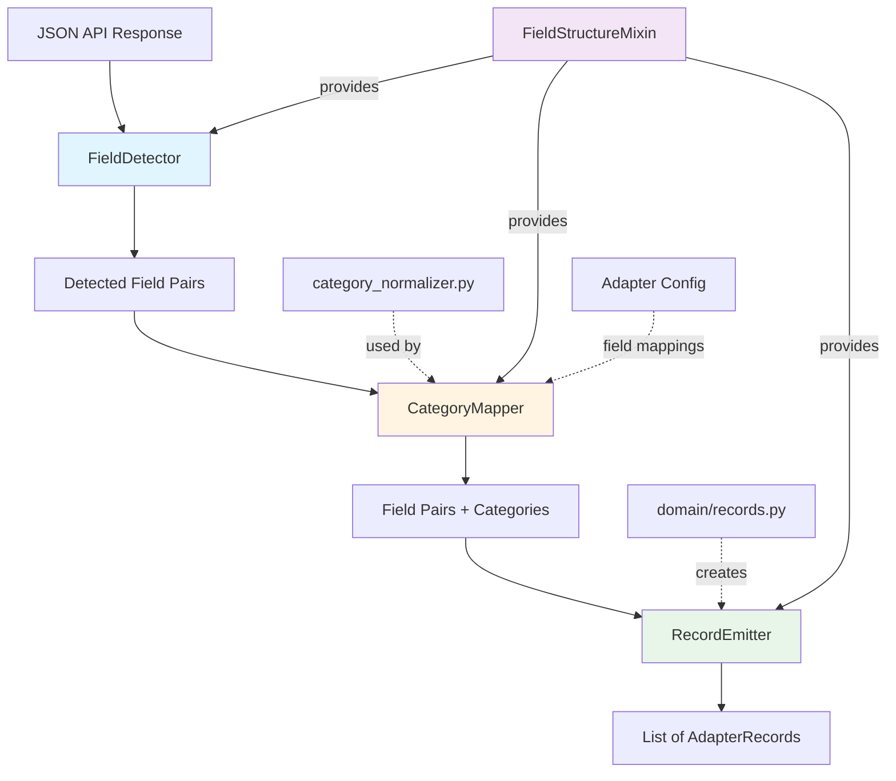

# Design Document: Field-Structure-Based Category Detection

## Overview

### Problem Statement

The Ethiopian exchange rate collection system uses 32 bank adapters to extract rate data from diverse sources (JSON APIs, HTML tables, text extraction). Each adapter must determine the **category** of each rate (cash, transactional, weighted_average) to enable proper filtering in the trusted view query.

Currently, adapters handle category detection inconsistently:
- **CBE adapter**: Hard-codes field name checks (`if "cashBuying" in data: category = "cash"`)
- **Wegagen adapter**: Defaults all rates to `category="transactional"` despite having `buying` and `tra_buying` fields
- **Rammis adapter**: Marks all rates as `category="UNKNOWN"`, making data invisible in trusted view
- **Addis Fortune adapter**: Hard-codes category strings for each field pair

This leads to **three critical problems**:
1. **Data loss**: UNKNOWN categories are excluded from trusted view
2. **Maintenance burden**: 32 adapters have scattered hard-coded category logic
3. **Missed opportunities**: Field structures signal multi-category data, but adapters emit single records

### Solution Approach

This design introduces **field-structure-based category detection** following the **No-Data-Loss Principle**:

> **When a bank API publishes structurally distinct field pairs (e.g., `buying` + `tra_buying`), the system SHALL emit one record per field pair, even if values are numerically identical.**

The solution provides:
1. **FieldDetector**: Identifies which rate field pairs exist in JSON structures
2. **CategoryMapper**: Maps field names to canonical categories using existing `category_normalizer.py`
3. **RecordEmitter**: Creates one AdapterRecord per detected field pair
4. **FieldStructureMixin**: Reusable composition mixin for adapters requiring minimal code

**Design Principles**:
- **Composition over inheritance**: Use mixins, don't modify base class hierarchy
- **Single responsibility**: Each component has one clear purpose
- **Dependency injection**: Components accept configuration for testability
- **Follow existing patterns**: Integrate with `adapters/base.py`, `domain/records.py`, `category_normalizer.py`

### Key Insight

**Field existence signals publishing intent**. If a bank includes both `buying` and `tra_buying` fields, they intend to publish both categories, regardless of whether values currently happen to be equal. Storing apparent duplicates is better than losing distinct rates.

---

## Architecture

### High-Level Component Diagram



### Component Responsibilities

| Component | Responsibility | Input | Output |
|-----------|---------------|-------|--------|
| **FieldDetector** | Find all buying/selling field pairs in JSON | JSON dict/list | List[(buy_field, sell_field)] |
| **CategoryMapper** | Map field names to canonical categories | Field name, context | Canonical category string |
| **RecordEmitter** | Create AdapterRecords from field pairs | Field pairs + data | List[AdapterRecord] |
| **FieldStructureMixin** | Provide reusable detection logic to adapters | Config dict | Helper methods |
| **category_normalizer** | Normalize category strings (existing module) | Raw category, context | Canonical category |

---

## Components and Interfaces

### 1. FieldDetector

**Purpose**: Identify all rate field pairs in an API response structure.

**Interface**:

```python
class FieldDetector:
    """Detects buying/selling field pairs in JSON structures."""
    
    def __init__(self, field_patterns: Optional[dict] = None):
        """
        Initialize detector with optional field patterns.
        
        Args:
            field_patterns: Optional dict of {field_name: category_hint}
                          for explicit field-to-category mappings
        """
        self.field_patterns = field_patterns or {}
        self._default_patterns = self._build_default_patterns()
    
    def detect_field_pairs(self, data: dict) -> List[FieldPair]:
        """
        Detect all buying/selling field pairs in data structure.
        
        Args:
            data: JSON dict from API response (attributes or rate object)
        
        Returns:
            List of FieldPair objects with (buy_field, sell_field, confidence)
        
        Example:
            data = {"buying": 162.00, "tra_buying": 162.00, 
                    "selling": 165.00, "tra_selling": 165.00}
            pairs = detector.detect_field_pairs(data)
            # Returns: [
            #   FieldPair("buying", "selling", confidence=0.9),
            #   FieldPair("tra_buying", "tra_selling", confidence=0.9)
            # ]
        """
        pass
    
    def _build_default_patterns(self) -> List[Tuple[str, str]]:
        """Build default patterns for common field structures."""
        return [
            # Pattern: explicit category prefixes
            (r"^cash_?buying$", r"^cash_?selling$"),
            (r"^tra_?buying$", r"^tra_?selling$"),
            (r"^trans.*buying$", r"^trans.*selling$"),
            (r"^weighted_?buying$", r"^weighted_?selling$"),
            
            # Pattern: camelCase explicit categories
            (r"^cashBuying$", r"^cashSelling$"),
            (r"^transactionalBuying$", r"^transactionalSelling$"),
            (r"^weightedBuying$", r"^weightedSelling$"),
            
            # Pattern: generic buying/selling (lowest confidence)
            (r"^buying$", r"^selling$"),
        ]
    
    def _match_pair(self, fields: set, buy_pattern: str, sell_pattern: str) -> Optional[Tuple[str, str]]:
        """Match a buying/selling pattern against available fields."""
        import re
        buy_field = None
        sell_field = None
        
        for field in fields:
            if re.match(buy_pattern, field, re.IGNORECASE):
                buy_field = field
            if re.match(sell_pattern, field, re.IGNORECASE):
                sell_field = field
        
        if buy_field and sell_field:
            return (buy_field, sell_field)
        return None


@dataclass
class FieldPair:
    """Represents a detected buying/selling field pair."""
    buy_field: str
    sell_field: str
    confidence: float = 1.0  # 0.0-1.0, higher = more confident match
    
    def __str__(self):
        return f"({self.buy_field}, {self.sell_field})"
```

**Implementation Notes**:
- Uses regex patterns to match common field naming conventions
- Returns pairs in order of confidence (explicit category prefixes first, generic last)
- Handles camelCase, snake_case, and kebab-case field names
- Skips pairs where only one field exists (incomplete data)

**Test Cases**:

```python
# Test 1: CBE pattern (explicit categories)
data = {
    "cashBuying": 162.00, "cashSelling": 165.00,
    "transactionalBuying": 162.00, "transactionalSelling": 165.00
}
pairs = detector.detect_field_pairs(data)
assert len(pairs) == 2
assert pairs[0].buy_field == "cashBuying"
assert pairs[1].buy_field == "transactionalBuying"

# Test 2: Wegagen pattern (prefix convention)
data = {
    "buying": 162.00, "selling": 165.00,
    "tra_buying": 162.00, "tra_selling": 165.00
}
pairs = detector.detect_field_pairs(data)
assert len(pairs) == 2

# Test 3: Rammis pattern (single pair)
data = {"buying": 162.00, "selling": 165.00}
pairs = detector.detect_field_pairs(data)
assert len(pairs) == 1

# Test 4: Incomplete pair (skip)
data = {"buying": 162.00, "tra_selling": 165.00}  # Mismatched
pairs = detector.detect_field_pairs(data)
assert len(pairs) == 0  # No complete pairs
```

---

### 2. CategoryMapper

**Purpose**: Map field names to canonical category codes using existing `category_normalizer.py`.

**Interface**:

```python
from pipeline.category_normalizer import normalize_category_with_context

class CategoryMapper:
    """Maps field names to canonical categories."""
    
    def __init__(self, 
                 default_category: str = "UNKNOWN",
                 field_mappings: Optional[Dict[str, str]] = None,
                 adapter_context: Optional[str] = None):
        """
        Initialize mapper with optional configuration.
        
        Args:
            default_category: Fallback category when field is ambiguous
            field_mappings: Explicit field-to-category mappings
            adapter_context: Adapter name for context-aware normalization
        """
        self.default_category = default_category
        self.field_mappings = field_mappings or {}
        self.adapter_context = adapter_context
    
    def map_field_to_category(self, field_name: str) -> str:
        """
        Map a field name to canonical category.
        
        Args:
            field_name: API field name (e.g., "cashBuying", "tra_buying")
        
        Returns:
            Canonical category: "cash", "transactional", "weighted_average", 
                               "indicative_reference", or default
        
        Example:
            mapper = CategoryMapper(default_category="transactional")
            mapper.map_field_to_category("cashBuying")  # → "cash"
            mapper.map_field_to_category("tra_buying")  # → "transactional"
            mapper.map_field_to_category("buying")      # → "transactional" (default)
        """
        # Check explicit mappings first
        if field_name in self.field_mappings:
            return self.field_mappings[field_name]
        
        # Use category normalizer with field name as context
        context = {"field_name": field_name}
        if self.adapter_context:
            context["adapter"] = self.adapter_context
        
        category = normalize_category_with_context("", context)
        
        # If normalizer returns UNKNOWN, use adapter default
        if category == "UNKNOWN":
            return self.default_category
        
        return category
    
    def map_field_pair(self, field_pair: FieldPair) -> str:
        """
        Map a field pair to category (uses buying field as representative).
        
        Args:
            field_pair: FieldPair with buy_field and sell_field
        
        Returns:
            Canonical category for the pair
        """
        return self.map_field_to_category(field_pair.buy_field)
```

**Integration with category_normalizer.py**:

The `CategoryMapper` delegates to the existing `normalize_category_with_context()` function, which already implements pattern matching for:
- `cash*` prefix → "cash"
- `tra*` / `trans*` / `txn*` prefix → "transactional"
- `weighted*` / `avg*` prefix → "weighted_average"
- `indicative` / `reference` → "indicative_reference"

**Configuration Example**:

```python
# Wegagen-specific configuration
wegagen_mapper = CategoryMapper(
    default_category="transactional",
    field_mappings={
        "buying": "cash",         # Explicit: buying → cash for Wegagen
        "tra_buying": "transactional",
        "selling": "cash",
        "tra_selling": "transactional"
    },
    adapter_context="wegagen"
)

# Generic mapper (relies on field name patterns)
generic_mapper = CategoryMapper(default_category="UNKNOWN")
```

**Test Cases**:

```python
# Test 1: Explicit category field names
mapper = CategoryMapper()
assert mapper.map_field_to_category("cashBuying") == "cash"
assert mapper.map_field_to_category("transactionalBuying") == "transactional"
assert mapper.map_field_to_category("weightedBuying") == "weighted_average"

# Test 2: Prefix patterns
assert mapper.map_field_to_category("tra_buying") == "transactional"
assert mapper.map_field_to_category("cash_buying") == "cash"

# Test 3: Ambiguous with default
mapper = CategoryMapper(default_category="transactional")
assert mapper.map_field_to_category("buying") == "transactional"

# Test 4: Explicit overrides
mapper = CategoryMapper(field_mappings={"buying": "cash"})
assert mapper.map_field_to_category("buying") == "cash"
```

---

### 3. RecordEmitter

**Purpose**: Create AdapterRecord objects from detected field pairs with mapped categories.

**Interface**:

```python
from domain.records import AdapterRecord
from decimal import Decimal
from datetime import date
from typing import Optional

class RecordEmitter:
    """Creates AdapterRecords from field pairs and raw data."""
    
    def emit_records_from_fields(
        self,
        data: dict,
        field_pairs: List[FieldPair],
        category_mapper: CategoryMapper,
        *,
        # Required AdapterRecord fields
        currency: str,
        effective_date: Optional[date] = None,
        effective_date_basis: str = "collection_date_fallback",
        source_record_id: Optional[str] = None,
        source_publication_id: Optional[str] = None,
        unit_multiplier: int = 1,
        # Optional fields
        currency_name: Optional[str] = None,
        quote_currency: Optional[str] = None,
        mapping_notes: Optional[List[str]] = None
    ) -> List[AdapterRecord]:
        """
        Emit one AdapterRecord per field pair.
        
        Args:
            data: Raw dict containing rate fields
            field_pairs: List of detected field pairs
            category_mapper: CategoryMapper for field-to-category mapping
            currency: Source currency code (e.g., "USD")
            effective_date: Effective date from source
            effective_date_basis: Date basis indicator
            source_record_id: Base source record key (will append category)
            source_publication_id: Publication key
            unit_multiplier: Unit multiplier
            currency_name: Optional currency name
            quote_currency: Optional quote currency
            mapping_notes: Optional mapping notes
        
        Returns:
            List of AdapterRecord objects (one per field pair)
        
        Example:
            data = {"buying": 162.00, "tra_buying": 162.00,
                    "selling": 165.00, "tra_selling": 165.00}
            pairs = [FieldPair("buying", "selling"),
                     FieldPair("tra_buying", "tra_selling")]
            
            records = emitter.emit_records_from_fields(
                data, pairs, mapper,
                currency="USD",
                source_record_id="123"
            )
            # Returns: [
            #   AdapterRecord(currency="USD", category="cash", 
            #                 buying_rate=162.00, source_record_key="123:cash"),
            #   AdapterRecord(currency="USD", category="transactional",
            #                 buying_rate=162.00, source_record_key="123:transactional")
            # ]
        """
        records = []
        
        for pair in field_pairs:
            # Extract rates from data
            buying_raw = data.get(pair.buy_field)
            selling_raw = data.get(pair.sell_field)
            
            # Skip if both rates are None/null
            buying_rate = self._safe_rate(buying_raw)
            selling_rate = self._safe_rate(selling_raw)
            if buying_rate is None and selling_rate is None:
                continue
            
            # Map field to category
            category = category_mapper.map_field_pair(pair)
            
            # Generate unique source_record_key with category suffix
            if source_record_id and len(field_pairs) > 1:
                src_key = f"{source_record_id}:{category}"
            else:
                src_key = source_record_id
            
            # Build mapping notes
            notes = (mapping_notes or []).copy()
            notes.append(f"field_structure:{pair.buy_field}/{pair.sell_field}")
            notes.append(f"category_detected:{category}")
            
            # Create record
            record = AdapterRecord(
                source_currency_code=currency,
                currency_name=currency_name,
                category=category,
                buying_rate=buying_rate,
                selling_rate=selling_rate,
                source_rate_text=f"{buying_raw}/{selling_raw}",
                effective_date=effective_date,
                effective_date_basis=effective_date_basis,
                source_record_key=src_key,
                source_publication_key=source_publication_id,
                quote_currency_code=quote_currency,
                unit_multiplier=unit_multiplier,
                raw_excerpt={
                    "original_id": source_record_id,
                    "field_pair": str(pair),
                    pair.buy_field: buying_raw,
                    pair.sell_field: selling_raw
                },
                mapping_notes=notes
            )
            records.append(record)
        
        return records
    
    @staticmethod
    def _safe_rate(raw) -> Optional[Decimal]:
        """Safely convert raw value to Decimal rate."""
        from pipeline.normalize import normalize_rate
        try:
            return normalize_rate(raw)
        except (ValueError, TypeError):
            return None
```

**Implementation Notes**:
- Generates unique `source_record_key` by appending category suffix when multiple records from same source item
- Skips pairs where both buying and selling are None (incomplete data)
- Includes field structure metadata in `raw_excerpt` for debugging
- Adds detection metadata to `mapping_notes` for traceability

**Test Cases**:

```python
# Test 1: Multiple categories from same source item
data = {"buying": 162.00, "tra_buying": 162.00,
        "selling": 165.00, "tra_selling": 165.00}
pairs = [FieldPair("buying", "selling"), FieldPair("tra_buying", "tra_selling")]
mapper = CategoryMapper(field_mappings={"buying": "cash", "tra_buying": "transactional"})

records = emitter.emit_records_from_fields(
    data, pairs, mapper,
    currency="USD", source_record_id="123"
)

assert len(records) == 2
assert records[0].category == "cash"
assert records[0].source_record_key == "123:cash"
assert records[1].category == "transactional"
assert records[1].source_record_key == "123:transactional"

# Test 2: Single category (no suffix)
data = {"buying": 162.00, "selling": 165.00}
pairs = [FieldPair("buying", "selling")]

records = emitter.emit_records_from_fields(
    data, pairs, mapper,
    currency="USD", source_record_id="456"
)

assert len(records) == 1
assert records[0].source_record_key == "456"  # No category suffix

# Test 3: Skip pairs with no rates
data = {"buying": None, "selling": None,
        "tra_buying": 162.00, "tra_selling": 165.00}
pairs = [FieldPair("buying", "selling"), FieldPair("tra_buying", "tra_selling")]

records = emitter.emit_records_from_fields(
    data, pairs, mapper,
    currency="USD", source_record_id="789"
)

assert len(records) == 1  # Only tra_buying/tra_selling pair
assert records[0].category == "transactional"
```

---

### 4. FieldStructureMixin

**Purpose**: Provide reusable composition mixin for adapters requiring minimal integration code.

**Interface**:

```python
class FieldStructureMixin:
    """
    Mixin providing field-structure-based category detection.
    
    Adapters using this mixin should:
    1. Inherit from both JSONAdapter and FieldStructureMixin
    2. Define FIELD_CONFIG class attribute (optional)
    3. Call detect_and_emit() from _parse_item() method
    
    Example:
        class WegagenAdapter(JSONAdapter, FieldStructureMixin):
            FIELD_CONFIG = {
                "field_mappings": {
                    "buying": "cash",
                    "tra_buying": "transactional"
                },
                "default_category": "transactional"
            }
            
            def _parse_item(self, item: dict) -> list:
                attrs = item["attributes"]
                return self.detect_and_emit(
                    attrs,
                    currency=attrs["code"],
                    source_record_id=item["id"],
                    effective_date=self._parse_iso_date(attrs["date"])
                )
    """
    
    # Configuration attribute (override in subclass)
    FIELD_CONFIG: dict = {}
    
    def __init__(self, *args, **kwargs):
        super().__init__(*args, **kwargs)
        self._detector = None
        self._mapper = None
        self._emitter = None
    
    @property
    def field_detector(self) -> FieldDetector:
        """Lazy-initialize FieldDetector from config."""
        if self._detector is None:
            config = self.FIELD_CONFIG
            field_patterns = config.get("field_patterns")
            self._detector = FieldDetector(field_patterns=field_patterns)
        return self._detector
    
    @property
    def category_mapper(self) -> CategoryMapper:
        """Lazy-initialize CategoryMapper from config."""
        if self._mapper is None:
            config = self.FIELD_CONFIG
            self._mapper = CategoryMapper(
                default_category=config.get("default_category", "UNKNOWN"),
                field_mappings=config.get("field_mappings"),
                adapter_context=self.get_adapter_key()
            )
        return self._mapper
    
    @property
    def record_emitter(self) -> RecordEmitter:
        """Lazy-initialize RecordEmitter."""
        if self._emitter is None:
            self._emitter = RecordEmitter()
        return self._emitter
    
    def detect_and_emit(
        self,
        data: dict,
        *,
        currency: str,
        effective_date: Optional[date] = None,
        effective_date_basis: str = "collection_date_fallback",
        source_record_id: Optional[str] = None,
        source_publication_id: Optional[str] = None,
        unit_multiplier: int = 1,
        currency_name: Optional[str] = None,
        quote_currency: Optional[str] = None,
        mapping_notes: Optional[List[str]] = None
    ) -> List[AdapterRecord]:
        """
        One-line method to detect field structure and emit records.
        
        This is the primary entry point for adapters using the mixin.
        
        Args:
            data: Dict containing rate fields (e.g., item["attributes"])
            currency: Source currency code
            effective_date: Effective date from source
            effective_date_basis: Date basis indicator
            source_record_id: Source record ID
            source_publication_id: Publication ID
            unit_multiplier: Unit multiplier
            currency_name: Optional currency name
            quote_currency: Optional quote currency
            mapping_notes: Optional mapping notes
        
        Returns:
            List of AdapterRecord objects
        """
        # Step 1: Detect field pairs
        field_pairs = self.field_detector.detect_field_pairs(data)
        
        # Step 2: Emit records with category mapping
        return self.record_emitter.emit_records_from_fields(
            data,
            field_pairs,
            self.category_mapper,
            currency=currency,
            effective_date=effective_date,
            effective_date_basis=effective_date_basis,
            source_record_id=source_record_id,
            source_publication_id=source_publication_id,
            unit_multiplier=unit_multiplier,
            currency_name=currency_name,
            quote_currency=quote_currency,
            mapping_notes=mapping_notes
        )
```

**Design Rationale**:
- **Composition over inheritance**: Mixin pattern allows adding functionality without modifying base classes
- **Lazy initialization**: Components created on first use, not in `__init__`
- **Configuration-driven**: FIELD_CONFIG class attribute provides declarative setup
- **One-line usage**: `detect_and_emit()` provides minimal-code integration for adapters

---

## Data Models

### FieldPair

```python
@dataclass
class FieldPair:
    """Represents a detected buying/selling field pair."""
    buy_field: str          # Field name for buying rate (e.g., "cashBuying")
    sell_field: str         # Field name for selling rate (e.g., "cashSelling")
    confidence: float = 1.0 # Confidence score (0.0-1.0)
    
    def __str__(self):
        return f"({self.buy_field}, {self.sell_field})"
```

### Configuration Schema

```python
# FIELD_CONFIG dictionary structure
{
    # Optional: Explicit field-to-category mappings (highest priority)
    "field_mappings": {
        "buying": "cash",
        "tra_buying": "transactional",
        "selling": "cash",
        "tra_selling": "transactional"
    },
    
    # Optional: Default category when field is ambiguous
    "default_category": "transactional",
    
    # Optional: Custom field patterns (rarely needed)
    "field_patterns": {
        "my_custom_buy_field": "custom_category"
    }
}
```

**Configuration Parser**:

```python
def parse_field_config(config_dict: dict) -> dict:
    """
    Parse and validate field configuration.
    
    Args:
        config_dict: Configuration dictionary
    
    Returns:
        Validated configuration dict
    
    Raises:
        ValueError: If configuration is invalid
    """
    from pipeline.category_normalizer import validate_category
    
    validated = {}
    
    # Validate field_mappings
    if "field_mappings" in config_dict:
        mappings = config_dict["field_mappings"]
        if not isinstance(mappings, dict):
            raise ValueError("field_mappings must be a dict")
        
        for field, category in mappings.items():
            if not isinstance(field, str) or not isinstance(category, str):
                raise ValueError(f"Invalid mapping: {field} → {category}")
            if not validate_category(category) and category != "UNKNOWN":
                raise ValueError(f"Invalid category: {category}")
        
        validated["field_mappings"] = mappings
    
    # Validate default_category
    if "default_category" in config_dict:
        default = config_dict["default_category"]
        if not validate_category(default) and default != "UNKNOWN":
            raise ValueError(f"Invalid default_category: {default}")
        validated["default_category"] = default
    
    # Pass through field_patterns (validated at runtime)
    if "field_patterns" in config_dict:
        validated["field_patterns"] = config_dict["field_patterns"]
    
    return validated


def print_field_config(config_dict: dict) -> str:
    """
    Pretty-print field configuration for readability.
    
    Args:
        config_dict: Configuration dictionary
    
    Returns:
        Formatted JSON string
    """
    import json
    return json.dumps(config_dict, indent=2, sort_keys=True)
```

**Round-Trip Property Test**:

```python
def test_config_round_trip():
    """Verify parse(print(config)) == config."""
    original = {
        "field_mappings": {
            "buying": "cash",
            "tra_buying": "transactional"
        },
        "default_category": "transactional"
    }
    
    # Parse → Print → Parse
    parsed = parse_field_config(original)
    printed = print_field_config(parsed)
    reparsed = parse_field_config(json.loads(printed))
    
    assert parsed == reparsed  # Round-trip property
```

---

## Code Examples

### Pattern 1: CBE (Explicit Category Field Names)

**Current Implementation** (hard-coded):

```python
# adapters/cbe/adapter.py (before)
_CATEGORY_FIELDS = {
    "cash": ("cashBuying", "cashSelling"),
    "transactional": ("transactionalBuying", "transactionalSelling"),
}

for category, (buy_field, sell_field) in _CATEGORY_FIELDS.items():
    buying = item.get(buy_field)
    selling = item.get(sell_field)
    if buying or selling:
        records.append(AdapterRecord(
            category=category,  # Hard-coded string
            buying_rate=buying,
            selling_rate=selling,
            ...
        ))
```

**New Implementation** (field detection):

```python
# adapters/cbe/adapter.py (after)
class CBEAdapter(JSONAdapter, FieldStructureMixin):
    """CBE adapter with field-structure-based detection."""
    
    # No explicit config needed - field names are self-describing
    FIELD_CONFIG = {}
    
    def _parse_er_item(self, item: dict, pub_id: str, effective_date: date) -> list:
        """Parse one ExchangeRate item using field detection."""
        currency = item.get("currency", {}).get("CurrencyCode", "").strip()
        if not currency:
            return []
        
        # One line: detect fields and emit records
        return self.detect_and_emit(
            item,
            currency=currency,
            effective_date=effective_date,
            effective_date_basis="source_published",
            source_record_id=item.get("id"),
            source_publication_id=pub_id,
            currency_name=item.get("currency", {}).get("CurrencyName")
        )
```

**Benefits**:
- No hard-coded category strings
- Automatically handles new categories if CBE adds them
- Centralized category logic in CategoryMapper
- Simpler code (one line vs. loop over dict)

---

### Pattern 2: Wegagen (Prefix Convention)

**Current Implementation** (default category):

```python
# adapters/wegagen/adapter.py (before)
def _parse_item(self, item: dict) -> list:
    attrs = item["attributes"]
    buying = self._safe_rate(attrs.get("buying"))
    selling = self._safe_rate(attrs.get("selling"))
    
    return [AdapterRecord(
        source_currency_code=attrs["code"],
        category=normalize_category("transactional"),  # Default all to transactional
        buying_rate=buying,
        selling_rate=selling,
        ...
    )]
```

**New Implementation** (field detection):

```python
# adapters/wegagen/adapter.py (after)
class WegagenAdapter(JSONAdapter, FieldStructureMixin):
    """Wegagen adapter with field-structure-based detection."""
    
    FIELD_CONFIG = {
        "field_mappings": {
            "buying": "cash",              # Wegagen: buying → cash
            "tra_buying": "transactional",
            "selling": "cash",
            "tra_selling": "transactional"
        },
        "default_category": "transactional"
    }
    
    def _parse_item(self, item: dict) -> list:
        """Parse one rate item using field detection."""
        attrs = item["attributes"]
        
        # Validate required fields
        if not attrs.get("code"):
            return []
        
        # One line: detect fields and emit records
        return self.detect_and_emit(
            attrs,
            currency=attrs["code"],
            effective_date=self._parse_iso_date(attrs.get("date")),
            effective_date_basis="source_published",
            source_record_id=str(item.get("id")),
            unit_multiplier=int(attrs.get("unit", 1) or 1),
            mapping_notes=["strapi_v4:populate_star"]
        )
```

**Expected Output**:
- **Before**: 1 record per currency (category=transactional)
- **After**: 2 records per currency (category=cash, category=transactional)

**Benefits**:
- Captures both cash and transactional rates
- No data loss when values are identical
- Future-proof if rates diverge
- Follows No-Data-Loss Principle

---

### Pattern 3: Rammis (Single Pair, Default Category)

**Current Implementation** (UNKNOWN category):

```python
# adapters/rammis/adapter.py (before)
def _parse_row(row: dict, category: str = "UNKNOWN") -> Optional[AdapterRecord]:
    buying = row.get("buying")
    selling = row.get("selling")
    
    return AdapterRecord(
        source_currency_code=row["currency"],
        category=category,  # Always UNKNOWN → excluded from trusted view
        buying_rate=buying,
        selling_rate=selling,
        ...
    )
```

**New Implementation** (field detection with default):

```python
# adapters/rammis/adapter.py (after)
class RammisAdapter(JSONAdapter, FieldStructureMixin):
    """Rammis adapter with field-structure-based detection."""
    
    FIELD_CONFIG = {
        "default_category": "transactional"  # Single pair defaults to transactional
    }
    
    def _process_data(self, data, **options) -> ParseResult:
        """Process API response array."""
        result = ParseResult()
        
        rates = data.get("rates", [])
        for row in rates:
            try:
                records = self._parse_row(row)
                result.records.extend(records)
            except Exception as exc:
                result.add_error(f"row:{row.get('id', '?')}:{exc}")
        
        return result
    
    def _parse_row(self, row: dict) -> list:
        """Parse one rate row using field detection."""
        currency = str(row.get("currency", "")).strip()
        if not currency:
            return []
        
        # One line: detect fields and emit records
        return self.detect_and_emit(
            row,
            currency=currency,
            effective_date=self._parse_iso_date(row.get("effective_date")),
            effective_date_basis="source_published",
            source_record_id=str(row.get("id")),
            mapping_notes=["single_pair:default_category"]
        )
```

**Expected Output**:
- **Before**: 1 record per currency (category=UNKNOWN) → invisible in trusted view
- **After**: 1 record per currency (category=transactional) → visible in trusted view

**Benefits**:
- Data becomes visible (no longer UNKNOWN)
- Uses default_category from config
- Still emits single record (correct for single-pair sources)
- Consistent with ADR-010 guidance

---

### Pattern 4: Addis (Wide-Row Structure)

**Current Implementation** (hard-coded field pairs):

```python
# adapters/addis_fortune/adapter.py (before)
# Cash record
result.records.append(AdapterRecord(
    category=normalize_category("cash"),  # Hard-coded string
    buying_rate=row.get("cashBuying"),
    selling_rate=row.get("cashSelling"),
    ...
))

# Transactional record
result.records.append(AdapterRecord(
    category=normalize_category("transactional"),  # Hard-coded string
    buying_rate=row.get("transBuying"),
    selling_rate=row.get("transSelling"),
    ...
))
```

**New Implementation** (field detection):

```python
# adapters/addis_fortune/adapter.py (after)
class AddisFortuneAdapter(BankAdapter, FieldStructureMixin):
    """Addis Fortune adapter with field-structure-based detection."""
    
    # No config needed - field names are explicit
    FIELD_CONFIG = {}
    
    def _parse_row(self, row: dict, today: date) -> List[AdapterRecord]:
        """Parse one rate row using field detection."""
        currency = row.get("currency", "").strip()
        if not currency:
            return []
        
        applicable_date = self._parse_af_date(row.get("applicable_date", ""))
        if not applicable_date or (today - applicable_date).days > STALENESS_DAYS:
            return []
        
        # One line: detect fields and emit records
        return self.detect_and_emit(
            row,
            currency=currency,
            effective_date=applicable_date,
            effective_date_basis="source_published",
            source_record_id=currency,  # No stable ID, use currency
            currency_name=row.get("currency_name"),
            mapping_notes=["fallback_source:addis_fortune", f"af_slug:{self._slug}"]
        )
```

**Benefits**:
- Eliminates duplicate record creation code
- Automatically skips pairs with zero rates (handled by emitter)
- No hard-coded category strings
- Simpler, more maintainable

---

### Pattern 5: Dynamic (Runtime Introspection)

**Use Case**: API with unknown or changing field structures.

```python
class DynamicAdapter(JSONAdapter, FieldStructureMixin):
    """Adapter for APIs with dynamic field structures."""
    
    FIELD_CONFIG = {
        "default_category": "UNKNOWN"  # Fallback when fields are ambiguous
    }
    
    def _parse_item(self, item: dict) -> list:
        """Parse item with dynamic field discovery."""
        # Extract all fields dynamically
        data = {}
        for key, value in item.items():
            if "buy" in key.lower() or "sell" in key.lower():
                data[key] = value
        
        if not data:
            return []
        
        # One line: detect fields and emit records
        return self.detect_and_emit(
            data,
            currency=item.get("currency", "UNKNOWN"),
            effective_date=self._parse_iso_date(item.get("date")),
            effective_date_basis="source_published",
            source_record_id=str(item.get("id")),
            mapping_notes=["dynamic_field_discovery"]
        )
```

**Benefits**:
- Handles arbitrary field structures
- No pre-configuration needed
- Uses pattern matching in FieldDetector
- Adapts to API changes automatically

---

## Error Handling

### Error Scenarios and Responses

| Scenario | Detection | Response |
|----------|-----------|----------|
| **No field pairs detected** | FieldDetector returns empty list | Return empty list (no records) |
| **Incomplete pair** (only buying or only selling) | FieldDetector skips pair | Pair not included in results |
| **Invalid category in config** | Parser validation | Raise ValueError with descriptive message |
| **Both rates are None/null** | RecordEmitter checks | Skip that pair (don't emit record) |
| **Invalid rate value** | normalize_rate() raises ValueError | Set rate to None, continue (handled by existing normalize logic) |
| **Missing required AdapterRecord field** | AdapterRecord validation | Raise ValueError (existing behavior) |

### Error Propagation Strategy

```python
# FieldDetector: Returns empty list on no matches (not an error)
field_pairs = detector.detect_field_pairs(data)
if not field_pairs:
    return []  # No records to emit

# CategoryMapper: Returns default category on no match (graceful degradation)
category = mapper.map_field_to_category(field_name)
# category is always valid (never raises)

# RecordEmitter: Skips pairs with no data (silent skip)
records = emitter.emit_records_from_fields(...)
# Records list may be shorter than field_pairs if some pairs skipped

# Mixin: Propagates exceptions from adapters' own parsing logic
try:
    records = self.detect_and_emit(...)
except ValueError as exc:
    result.add_error(str(exc))  # Adapter handles its own errors
```

**Design Principle**: Components use **return empty** or **use defaults** rather than raising exceptions, allowing adapters to handle error reporting at the appropriate level.

---

## Testing Strategy

### Unit Tests

**Test each component in isolation with concrete examples:**

1. **FieldDetector Tests**:
   - Test explicit category field names (CBE pattern)
   - Test prefix conventions (Wegagen pattern)
   - Test single pairs (Rammis pattern)
   - Test wide-row structures (Addis pattern)
   - Test incomplete pairs (skip behavior)
   - Test empty data (return empty list)

2. **CategoryMapper Tests**:
   - Test explicit mappings take precedence
   - Test pattern matching for common prefixes
   - Test default category fallback
   - Test context-aware normalization
   - Test all canonical categories

3. **RecordEmitter Tests**:
   - Test multiple records from same source
   - Test source_record_key uniqueness with category suffix
   - Test single record (no category suffix)
   - Test skip pairs with no rates
   - Test metadata in raw_excerpt and mapping_notes

4. **FieldStructureMixin Tests**:
   - Test lazy initialization
   - Test config parsing
   - Test one-line detect_and_emit() usage
   - Test composition with JSONAdapter

5. **Configuration Parser Tests**:
   - Test valid configuration parsing
   - Test invalid category rejection
   - Test round-trip property: `parse(print(config)) == config`
   - Test pretty-printer formatting

### Property-Based Tests

**Use property-based testing to verify correctness properties across random inputs:**

```python
from hypothesis import given, strategies as st
from hypothesis.strategies import composite
import pytest

# Custom strategy for generating API response structures
@composite
def api_response_with_field_pairs(draw, min_pairs=1, max_pairs=3):
    """Generate random API responses with N field pairs."""
    n_pairs = draw(st.integers(min_value=min_pairs, max_value=max_pairs))
    
    data = {}
    pairs = []
    
    for i in range(n_pairs):
        # Generate field names
        category_prefix = draw(st.sampled_from(["cash", "tra", "trans", "weighted", ""]))
        if category_prefix:
            buy_field = f"{category_prefix}_buying"
            sell_field = f"{category_prefix}_selling"
        else:
            buy_field = f"buying{i if i > 0 else ''}"
            sell_field = f"selling{i if i > 0 else ''}"
        
        # Generate rate values
        buying_val = draw(st.decimals(min_value=100, max_value=200, places=4))
        selling_val = draw(st.decimals(min_value=100, max_value=200, places=4))
        
        data[buy_field] = float(buying_val)
        data[sell_field] = float(selling_val)
        pairs.append((buy_field, sell_field))
    
    return data, pairs


# Property 1: Completeness - detect exactly N pairs
@given(api_response_with_field_pairs())
def test_detector_completeness_property(response_data):
    """FOR ALL responses with N field pairs, detector SHALL identify exactly N pairs."""
    data, expected_pairs = response_data
    detector = FieldDetector()
    
    detected = detector.detect_field_pairs(data)
    
    # Completeness: detected count == expected count
    assert len(detected) == len(expected_pairs), \
        f"Expected {len(expected_pairs)} pairs, detected {len(detected)}"


# Property 2: Validity - all detected fields exist in source
@given(api_response_with_field_pairs())
def test_detector_validity_property(response_data):
    """FOR ALL detected pairs, both field names SHALL exist in source."""
    data, _ = response_data
    detector = FieldDetector()
    
    detected = detector.detect_field_pairs(data)
    
    # Validity: all detected fields must exist
    for pair in detected:
        assert pair.buy_field in data, f"Buy field {pair.buy_field} not in source"
        assert pair.sell_field in data, f"Sell field {pair.sell_field} not in source"


# Property 3: Structure independence - detection based on field names, not values
@given(api_response_with_field_pairs(), st.data())
def test_detector_structure_independence_property(response_data, data_strategy):
    """FOR ALL responses, changing values SHALL NOT change detected pairs."""
    data, _ = response_data
    detector = FieldDetector()
    
    # Detect pairs from original data
    pairs1 = detector.detect_field_pairs(data)
    
    # Change values (keep structure)
    modified_data = {}
    for key in data.keys():
        new_val = data_strategy.draw(st.decimals(min_value=1, max_value=999, places=4))
        modified_data[key] = float(new_val)
    
    # Detect pairs from modified data
    pairs2 = detector.detect_field_pairs(modified_data)
    
    # Structure independence: same pairs detected
    assert len(pairs1) == len(pairs2)
    assert {(p.buy_field, p.sell_field) for p in pairs1} == \
           {(p.buy_field, p.sell_field) for p in pairs2}


# Property 4: Category mapping idempotence
@given(st.sampled_from(["cashBuying", "tra_buying", "transactionalBuying", "buying"]))
def test_category_mapper_idempotence_property(field_name):
    """FOR ALL field names F, map(F) == map(map(F))."""
    mapper = CategoryMapper()
    
    category1 = mapper.map_field_to_category(field_name)
    category2 = mapper.map_field_to_category(category1)  # Map the category itself
    
    # Idempotence: mapping a category should return itself
    # (category strings are already canonical)
    from pipeline.category_normalizer import CANONICAL_CATEGORIES
    if category1 in CANONICAL_CATEGORIES:
        assert category2 == category1 or category2 == "UNKNOWN"


# Property 5: Category mapping determinism
@given(st.sampled_from(["cashBuying", "tra_buying", "transactionalBuying", "buying"]))
def test_category_mapper_determinism_property(field_name):
    """FOR ALL field names F, map(F) called twice SHALL return same result."""
    mapper = CategoryMapper()
    
    category1 = mapper.map_field_to_category(field_name)
    category2 = mapper.map_field_to_category(field_name)
    
    # Determinism: same input → same output
    assert category1 == category2


# Property 6: No-Data-Loss Principle
@given(api_response_with_field_pairs(min_pairs=2, max_pairs=2), st.decimals(min_value=100, max_value=200))
def test_emitter_no_data_loss_property(response_data, shared_value):
    """FOR ALL pairs with different field names, emit 2 records even if values equal."""
    data, pairs = response_data
    
    # Force values to be identical
    for buy, sell in pairs:
        data[buy] = float(shared_value)
        data[sell] = float(shared_value)
    
    detector = FieldDetector()
    mapper = CategoryMapper()
    emitter = RecordEmitter()
    
    detected_pairs = detector.detect_field_pairs(data)
    records = emitter.emit_records_from_fields(
        data, detected_pairs, mapper,
        currency="USD",
        source_record_id="test"
    )
    
    # No-Data-Loss: different field names → multiple records even if values equal
    assert len(records) >= 2, f"Expected ≥2 records, got {len(records)}"


# Property 7: Source record key uniqueness
@given(api_response_with_field_pairs(min_pairs=1, max_pairs=3))
def test_emitter_key_uniqueness_property(response_data):
    """FOR ALL records from same source, source_record_keys SHALL be unique."""
    data, _ = response_data
    
    detector = FieldDetector()
    mapper = CategoryMapper()
    emitter = RecordEmitter()
    
    detected_pairs = detector.detect_field_pairs(data)
    records = emitter.emit_records_from_fields(
        data, detected_pairs, mapper,
        currency="USD",
        source_record_id="test_id"
    )
    
    # Uniqueness: all keys distinct
    keys = [r.source_record_key for r in records]
    assert len(keys) == len(set(keys)), f"Duplicate keys found: {keys}"


# Property 8: Source record key stability
@given(api_response_with_field_pairs())
def test_emitter_key_stability_property(response_data):
    """FOR ALL records, parsing same data twice SHALL produce same keys."""
    data, _ = response_data
    
    detector = FieldDetector()
    mapper = CategoryMapper()
    emitter = RecordEmitter()
    
    detected_pairs = detector.detect_field_pairs(data)
    
    # Parse twice
    records1 = emitter.emit_records_from_fields(
        data, detected_pairs, mapper,
        currency="USD",
        source_record_id="stable_id"
    )
    
    records2 = emitter.emit_records_from_fields(
        data, detected_pairs, mapper,
        currency="USD",
        source_record_id="stable_id"
    )
    
    # Stability: same keys generated
    keys1 = sorted([r.source_record_key for r in records1])
    keys2 = sorted([r.source_record_key for r in records2])
    assert keys1 == keys2


# Property 9: Configuration round-trip
@given(st.dictionaries(
    keys=st.sampled_from(["buying", "tra_buying", "cashBuying", "transactionalBuying"]),
    values=st.sampled_from(["cash", "transactional", "weighted_average"]),
    min_size=1, max_size=4
))
def test_config_round_trip_property(field_mappings):
    """FOR ALL valid configs C, parse(print(C)) SHALL equal C."""
    config = {
        "field_mappings": field_mappings,
        "default_category": "transactional"
    }
    
    # Parse
    parsed = parse_field_config(config)
    
    # Print
    printed = print_field_config(parsed)
    
    # Parse again
    import json
    reparsed = parse_field_config(json.loads(printed))
    
    # Round-trip property
    assert parsed == reparsed
```

**Property Test Coverage**:

| Property | What It Tests | Why It Matters |
|----------|---------------|----------------|
| Completeness | Detector finds all N pairs | No missed data |
| Validity | Detected fields exist in source | No hallucinated fields |
| Structure Independence | Detection uses names, not values | Robust to value changes |
| Idempotence | map(F) == map(map(F)) | Consistent normalization |
| Determinism | Same input → same output | Predictable behavior |
| No-Data-Loss | Distinct fields → multiple records | Core principle verification |
| Key Uniqueness | All keys are distinct | No collisions |
| Key Stability | Same data → same keys | Identity stability |
| Round-Trip | parse(print(C)) == C | Config integrity |

Now I'll use the prework tool to analyze the acceptance criteria for testability.

<function_calls>
<invoke name="prework">
<parameter name="featureName">field-structure-category-detection


### Integration Tests

**Test adapter integration with real bank data:**

```python
# Test 1: CBE adapter with real October 21 data
def test_cbe_adapter_field_detection_integration():
    """Verify CBE adapter emits 2 categories per currency."""
    with open("fixtures/cbe/2026-10-21.json") as f:
        raw_json = f.read()
    
    adapter = CBEAdapter()
    result = adapter.parse(raw_json)
    
    # Should have both cash and transactional records
    usd_records = [r for r in result.records if r.source_currency_code == "USD"]
    assert len(usd_records) == 2
    
    categories = {r.category for r in usd_records}
    assert categories == {"cash", "transactional"}


# Test 2: Wegagen adapter emits multiple categories
def test_wegagen_adapter_field_detection_integration():
    """Verify Wegagen adapter emits cash + transactional."""
    with open("fixtures/wegagen/2026-10-21.json") as f:
        raw_json = f.read()
    
    adapter = WegagenAdapter()
    result = adapter.parse(raw_json)
    
    # Should have 2 records per currency (cash + transactional)
    usd_records = [r for r in result.records if r.source_currency_code == "USD"]
    assert len(usd_records) == 2
    
    # Verify source_record_key uniqueness
    keys = [r.source_record_key for r in usd_records]
    assert len(keys) == len(set(keys))
    assert all(":" in k for k in keys)  # Should have category suffix


# Test 3: Rammis adapter uses default category
def test_rammis_adapter_field_detection_integration():
    """Verify Rammis adapter emits single record with default category."""
    with open("fixtures/rammis/2026-10-21.json") as f:
        raw_json = f.read()
    
    adapter = RammisAdapter()
    result = adapter.parse(raw_json)
    
    # Should have 1 record per currency
    usd_records = [r for r in result.records if r.source_currency_code == "USD"]
    assert len(usd_records) == 1
    
    # Category should be transactional (not UNKNOWN)
    assert usd_records[0].category == "transactional"


# Test 4: Backward compatibility - unmigrated adapter still works
def test_unmigrated_adapter_still_works():
    """Verify adapters not using field detection continue working."""
    # Test an adapter that hasn't been migrated yet
    from adapters.dbe.adapter import DBEAdapter
    
    with open("fixtures/dbe/normal.html") as f:
        raw_html = f.read()
    
    adapter = DBEAdapter()
    result = adapter.parse(raw_html, category="transactional")
    
    # Should still work with existing implementation
    assert len(result.records) > 0
    assert all(r.category == "transactional" for r in result.records)
```

### Example-Based Tests

**Test specific patterns from requirements:**

```python
# Test Pattern A: CBE (explicit category field names)
def test_pattern_a_cbe_explicit_categories():
    """Test CBE pattern with explicit cashBuying/transactionalBuying."""
    data = {
        "cashBuying": 162.00,
        "cashSelling": 165.00,
        "transactionalBuying": 162.00,
        "transactionalSelling": 165.00
    }
    
    detector = FieldDetector()
    pairs = detector.detect_field_pairs(data)
    
    assert len(pairs) == 2
    assert any(p.buy_field == "cashBuying" for p in pairs)
    assert any(p.buy_field == "transactionalBuying" for p in pairs)


# Test Pattern B: Wegagen (prefix convention)
def test_pattern_b_wegagen_prefix():
    """Test Wegagen pattern with buying/tra_buying prefix."""
    data = {
        "buying": 162.00,
        "selling": 165.00,
        "tra_buying": 162.00,
        "tra_selling": 165.00
    }
    
    detector = FieldDetector()
    pairs = detector.detect_field_pairs(data)
    
    assert len(pairs) == 2
    assert any(p.buy_field == "buying" for p in pairs)
    assert any(p.buy_field == "tra_buying" for p in pairs)


# Test Pattern C: Rammis (single pair)
def test_pattern_c_rammis_single_pair():
    """Test Rammis pattern with single buying/selling pair."""
    data = {
        "buying": 162.00,
        "selling": 165.00
    }
    
    detector = FieldDetector()
    pairs = detector.detect_field_pairs(data)
    
    assert len(pairs) == 1
    assert pairs[0].buy_field == "buying"
    assert pairs[0].sell_field == "selling"


# Test Pattern D: Addis (wide-row)
def test_pattern_d_addis_wide_row():
    """Test Addis Fortune pattern with cashBuying/transBuying."""
    data = {
        "cashBuying": 162.00,
        "cashSelling": 165.00,
        "transBuying": 162.00,
        "transSelling": 165.00
    }
    
    detector = FieldDetector()
    pairs = detector.detect_field_pairs(data)
    
    assert len(pairs) == 2
    assert any(p.buy_field == "cashBuying" for p in pairs)
    assert any(p.buy_field == "transBuying" for p in pairs)


# Test Pattern E: Dynamic (runtime discovery)
def test_pattern_e_dynamic_discovery():
    """Test dynamic pattern with unpredictable field names."""
    data = {
        "rate1_buy": 162.00,
        "rate1_sell": 165.00,
        "rate2_buy": 162.00,
        "rate2_sell": 165.00
    }
    
    # This would require extending patterns or custom config
    detector = FieldDetector(field_patterns={
        "rate1_buy": "rate1_sell",
        "rate2_buy": "rate2_sell"
    })
    
    # Custom pattern matching would be needed for truly dynamic names
    # This example shows the config mechanism works
```

---

## Correctness Properties

*A property is a characteristic or behavior that should hold true across all valid executions of a system—essentially, a formal statement about what the system should do. Properties serve as the bridge between human-readable specifications and machine-verifiable correctness guarantees.*

Now I'll analyze the acceptance criteria to determine which are testable as properties: