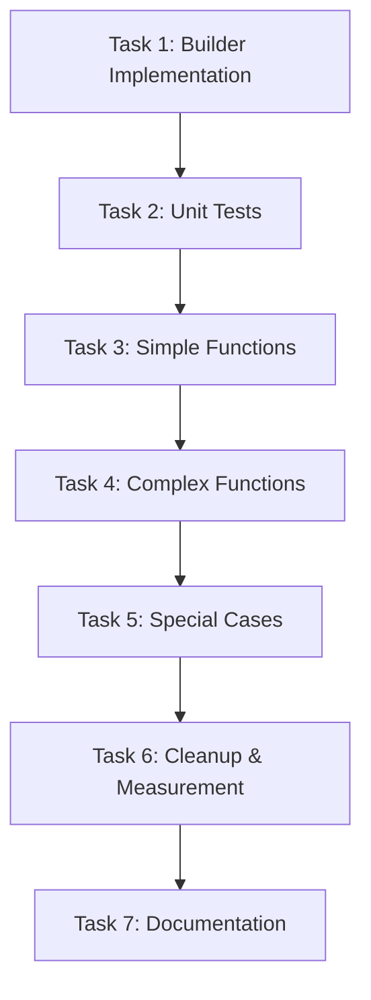

# Tasks: Trusted View Query Builder

**Feature Name:** trusted-view-query-builder  
**Spec Type:** Feature (New)  
**Status:** Ready for Implementation  
**Created:** 2026-10-14  
**Estimated Duration:** 2-3 days

---

## Task Overview

| Phase | Tasks | Duration | Dependencies |
|-------|-------|----------|--------------|
| Phase 1 | Builder Implementation (Tasks 1-2) | 4 hours | None |
| Phase 2 | Function Migration (Tasks 3-4) | 6 hours | Phase 1 |
| Phase 3 | Final Migration & Cleanup (Tasks 5-6) | 4 hours | Phase 2 |
| **Total** | **6 tasks** | **14 hours (~2 days)** | |

---

## Phase 1: Builder Implementation

### Task 1: Implement TrustedRatesQueryBuilder Class

**Objective:** Create the core query builder with all methods.

**Acceptance Criteria:**
- [ ] Create `TrustedRatesQueryBuilder` class in `trusted_view/query.py`
- [ ] Implement all filter methods: `with_source()`, `with_currency()`, `with_category()`, `major_currencies_only()`, `with_date()`, `with_date_range()`
- [ ] Implement aggregation methods: `best_per_bank()`, `best_per_currency()`, `group_by_date()`, `group_by_bank()`
- [ ] Implement ordering methods: `order_by_buying_rate()`, `order_by_bank_name()`, `order_by_currency()`, `order_by_date()`
- [ ] Implement execution methods: `execute()`, `get_sql()`, `get_params()`
- [ ] Implement private query building methods: `_build_query()`, `_build_select()`, `_build_joins()`, `_build_where()`, `_build_order_by()`
- [ ] Implement row transformation: `_to_rows()`, `_to_row()`
- [ ] Add comprehensive docstrings to all methods
- [ ] Add type hints to all methods

**Implementation Notes:**
- **LOCKED rules** must be in `_build_where()` method (single source of truth)
- Use method chaining (return `self` from filter/aggregation/ordering methods)
- Parameterized queries only (prevent SQL injection)
- Standard 4-table JOIN pattern in `_build_joins()`
- Computed field `is_provisional` in `_to_row()`

**Files to Create/Modify:**
- `trusted_view/query.py` (add TrustedRatesQueryBuilder class)

**Verification:**
```bash
python -c "from trusted_view.query import TrustedRatesQueryBuilder; print('Import successful')"
```

**Time Estimate:** 3 hours

---

### Task 2: Create Unit Tests for QueryBuilder

**Objective:** Comprehensive unit tests for all builder methods.

**Acceptance Criteria:**
- [ ] Create `tests/test_trusted_view_query_builder.py`
- [ ] Test builder initialization
- [ ] Test method chaining (returns self)
- [ ] Test LOCKED rules enforcement (always present in WHERE clause)
- [ ] Test all filter methods (with_source, with_currency, etc.)
- [ ] Test filter combination (multiple filters with AND)
- [ ] Test aggregation methods (best_per_bank, DISTINCT ON)
- [ ] Test ordering methods (order_by_buying_rate, default ordering)
- [ ] Test row transformation (`is_provisional` computed correctly)
- [ ] Test query inspection (`get_sql()`, `get_params()`)
- [ ] Test SQL injection prevention (parameterized queries)
- [ ] Achieve 90%+ code coverage on builder class

**Test Classes:**
- `TestQueryBuilderConstruction`
- `TestLockedRulesEnforcement`
- `TestFilterMethods`
- `TestAggregationMethods`
- `TestOrderingMethods`
- `TestRowTransformation`
- `TestQueryInspection`

**Files to Create:**
- `tests/test_trusted_view_query_builder.py`

**Verification:**
```bash
pytest tests/test_trusted_view_query_builder.py -v
# Should show 20+ tests passing

pytest tests/test_trusted_view_query_builder.py --cov=trusted_view.query --cov-report=term
# Should show 90%+ coverage on builder class
```

**Time Estimate:** 1 hour

---

## Phase 2: Function Migration (First Half)

### Task 3: Migrate Simple Query Functions

**Objective:** Migrate 6 simple query functions to use builder.

**Target Functions:**
1. `get_trusted_rates(conn, source_id=None)`
2. `get_trusted_rates_by_currency(conn, currency_code)`
3. `get_available_currencies(conn)`
4. `get_available_banks(conn)`
5. `get_search_suggestions(conn)` (calls other functions)
6. `get_available_dates(conn)` (keep as-is or migrate - simple query)

**Acceptance Criteria:**
- [ ] Rewrite each function to use `TrustedRatesQueryBuilder` internally
- [ ] Keep function signatures unchanged (backward compatible)
- [ ] Keep return types unchanged (list of dicts)
- [ ] Run all tests after each function migration
- [ ] All 429 tests pass
- [ ] Compare output with baseline (should be identical)

**Migration Pattern:**
```python
# Before:
def get_trusted_rates_by_currency(conn, currency_code: str) -> list:
    query = f"""
        {_TRUSTED_SELECT}
        WHERE {_TRUSTED_WHERE}
          AND o.source_currency_code = %s
        ORDER BY o.buying_rate DESC NULLS LAST
    """
    with conn.cursor() as cur:
        cur.execute(query, (currency_code,))
        cols = [d[0] for d in cur.description]
        return [_to_row(cols, row) for row in cur.fetchall()]

# After:
def get_trusted_rates_by_currency(conn, currency_code: str) -> list:
    """Return all banks' trusted rates for a single currency code."""
    return (TrustedRatesQueryBuilder(conn)
            .with_currency(currency_code)
            .order_by_buying_rate(desc=True)
            .execute())
```

**Files to Modify:**
- `trusted_view/query.py`

**Verification:**
```bash
# After migrating each function
pytest -v

# Verify output matches baseline
python -c "
from trusted_view.query import get_trusted_rates_by_currency
from db.manager import DatabaseManager
DatabaseManager.initialize()
with DatabaseManager.connection() as conn:
    results = get_trusted_rates_by_currency(conn, 'USD')
    print(f'Found {len(results)} rates')
"
```

**Time Estimate:** 2 hours

---

### Task 4: Migrate Complex Query Functions

**Objective:** Migrate 4 complex query functions with aggregation/post-processing.

**Target Functions:**
1. `get_best_rates_by_currency(conn, currency_code)` - Uses best_per_bank() + post-sort
2. `get_currency_matrix(conn, major_only=False)` - Uses best_per_bank() + matrix building
3. `get_history_by_currency(conn, currency_code, effective_date=None)` - Uses best_per_bank() + optional date filter
4. `get_bank_rates_pivoted(conn, source_id)` - Calls get_trusted_rates() + pivoting logic

**Acceptance Criteria:**
- [ ] Migrate each function to use builder
- [ ] Keep post-processing logic (pivoting, matrix building) unchanged
- [ ] Function signatures unchanged
- [ ] Return types unchanged
- [ ] All 429 tests pass after each migration
- [ ] Output identical to baseline

**Special Considerations:**
- `get_best_rates_by_currency()` needs post-processing sort (DISTINCT ON doesn't guarantee cross-group order)
- `get_currency_matrix()` builds matrix from results (keep this logic)
- `get_bank_rates_pivoted()` can delegate to already-migrated `get_trusted_rates()`

**Files to Modify:**
- `trusted_view/query.py`

**Verification:**
```bash
pytest -v

# Specific tests for complex functions
pytest tests/ -k "matrix or pivoted or best_rates" -v
```

**Time Estimate:** 4 hours

---

## Phase 3: Final Migration & Cleanup

### Task 5: Handle Special Case Functions

**Objective:** Decide on migration strategy for 2 special-case functions.

**Target Functions:**
1. `get_pending_review_observations(conn)` - Unique query with previous version JOIN
2. `get_observation_with_warnings(conn, logical_key)` - Single observation lookup

**Options:**
- **Option A:** Keep as-is (unique queries that don't benefit from builder)
- **Option B:** Extend builder to support these cases
- **Option C:** Partially migrate (use builder WHERE clause only)

**Recommendation:** **Option A** (keep as-is)
- These queries are unique (self-join, single lookup)
- Not part of the duplication problem
- Can be migrated later if needed

**Acceptance Criteria:**
- [ ] Review these functions
- [ ] Decide on approach (document in code comments)
- [ ] If keeping as-is, add comment explaining why
- [ ] All 429 tests still pass

**Files to Modify:**
- `trusted_view/query.py` (possibly add comments)

**Verification:**
```bash
pytest tests/ -k "pending_review or observation_with_warnings" -v
```

**Time Estimate:** 1 hour

---

### Task 6: Cleanup and Code Reduction Measurement

**Objective:** Remove deprecated code and measure improvements.

**Acceptance Criteria:**
- [ ] Remove `_TRUSTED_WHERE` constant (no longer used)
- [ ] Remove `_TRUSTED_SELECT` constant (no longer used)
- [ ] Remove old `_to_row()` function if standalone (now in builder)
- [ ] Update module docstring with builder usage examples
- [ ] Add docstring to builder class with examples
- [ ] Measure code reduction (before vs after line count)
- [ ] Run full test suite - all 429 tests pass
- [ ] Verify no SQL duplication remains

**Code Reduction Measurement:**
```bash
# Before refactoring (baseline)
git show HEAD~1:trusted_view/query.py | wc -l
# Should show ~450 lines

# After refactoring
wc -l trusted_view/query.py
# Should show ~300 lines

# Calculate reduction
# Expected: 150+ lines eliminated (33% reduction)
```

**Duplication Check:**
```bash
# Verify _TRUSTED_WHERE not duplicated
grep -c "_TRUSTED_WHERE" trusted_view/query.py
# Should be 0 (removed entirely)

# Verify LOCKED rules in one place
grep -c "o.is_current = TRUE" trusted_view/query.py
# Should be 1 (in _build_where() only)
```

**Files to Modify:**
- `trusted_view/query.py`

**Verification:**
```bash
# Full test suite
pytest -v
# All 429 tests should pass

# Code metrics
pytest --cov=trusted_view.query --cov-report=html
# Open htmlcov/index.html to verify coverage

# Verify API still works
curl http://localhost:5000/rates
curl http://localhost:5000/rates/by-currency/USD
```

**Time Estimate:** 1 hour

---

### Task 7: Documentation and Final Verification

**Objective:** Complete documentation and final verification.

**Acceptance Criteria:**
- [ ] Update README with query builder usage
- [ ] Add examples to builder class docstring
- [ ] Document migration decisions (special-case functions)
- [ ] Create before/after comparison in doc comments
- [ ] Final test run - all 429 tests pass
- [ ] Performance benchmark (no regression)
- [ ] Code review ready

**Documentation Updates:**

**Builder Class Docstring Examples:**
```python
class TrustedRatesQueryBuilder:
    """
    Composable query builder for trusted exchange rates.
    
    Examples:
        # Simple currency filter
        rates = (TrustedRatesQueryBuilder(conn)
                 .with_currency("USD")
                 .execute())
        
        # Best rate per bank
        best_rates = (TrustedRatesQueryBuilder(conn)
                      .with_currency("USD")
                      .best_per_bank()
                      .order_by_buying_rate(desc=True)
                      .execute())
        
        # Major currencies for specific date
        rates = (TrustedRatesQueryBuilder(conn)
                 .major_currencies_only()
                 .with_date(date(2026, 10, 14))
                 .order_by_currency()
                 .execute())
    """
```

**Module Docstring Update:**
```python
"""
trusted_view/query.py — trusted current-rate read model.

LOCKED rules:
- Exclude rejected observations and ambiguous identities.
- Use latest valid version (is_current=TRUE).
- Never select by fetched_at alone — respect version chain.
- Show effective_date and last fetch separately.
- Unknown category/currency excluded until reviewed.
- Provisional sources visibly labeled (gap review L).
- Pending review shows uncertainty warning (gap review C).

Query Builder:
    Use TrustedRatesQueryBuilder for composable query construction.
    All LOCKED rules enforced automatically.
    
    Example:
        rates = (TrustedRatesQueryBuilder(conn)
                 .with_currency("USD")
                 .best_per_bank()
                 .execute())

Acceptance tests 19–22.
"""
```

**Performance Benchmark:**
```python
# tests/performance/test_query_builder_performance.py

import time
from trusted_view.query import get_trusted_rates_by_currency

def test_no_performance_regression(db_conn, baseline_time):
    """Verify query builder doesn't regress performance."""
    iterations = 100
    
    start = time.time()
    for _ in range(iterations):
        results = get_trusted_rates_by_currency(db_conn, "USD")
    elapsed = time.time() - start
    
    avg_time = elapsed / iterations
    
    # Should be within 5% of baseline
    assert avg_time < baseline_time * 1.05, \
        f"Performance regression: {avg_time:.3f}s vs {baseline_time:.3f}s baseline"
```

**Files to Modify:**
- `trusted_view/query.py` (docstrings)
- `README.md` (optional usage section)
- `tests/performance/test_query_builder_performance.py` (new)

**Final Verification Checklist:**
- [ ] All 429 tests pass
- [ ] Code reduction measured (150+ lines)
- [ ] No SQL duplication remains
- [ ] LOCKED rules in single location
- [ ] Performance benchmarked (no regression)
- [ ] Documentation complete
- [ ] Code review approved

**Verification:**
```bash
# Full test suite
pytest -v
# Expected: 429 passed

# Performance test
pytest tests/performance/test_query_builder_performance.py -v

# Code coverage
pytest --cov=trusted_view.query --cov-report=term
# Expected: 90%+ coverage

# Line count
wc -l trusted_view/query.py
# Expected: ~300 lines (vs 450 before = 33% reduction)
```

**Time Estimate:** 2 hours

---

## Task Dependencies



---

## Task Checklist

### Phase 1: Builder Implementation (4 hours)
- [ ] Task 1: Implement TrustedRatesQueryBuilder Class (3h)
- [ ] Task 2: Create Unit Tests for QueryBuilder (1h)

### Phase 2: Function Migration (6 hours)
- [ ] Task 3: Migrate Simple Query Functions (2h)
- [ ] Task 4: Migrate Complex Query Functions (4h)

### Phase 3: Final Migration & Cleanup (4 hours)
- [ ] Task 5: Handle Special Case Functions (1h)
- [ ] Task 6: Cleanup and Code Reduction Measurement (1h)
- [ ] Task 7: Documentation and Final Verification (2h)

---

## Success Criteria Summary

### Must Have (MVP)
1. ✅ TrustedRatesQueryBuilder implemented and tested
2. ✅ 10 main query functions migrated
3. ✅ All 429 tests pass
4. ✅ Code reduction 150+ lines (33%)
5. ✅ LOCKED rules in single location

### Should Have (Full Success)
6. ✅ Special case functions decided (keep as-is or migrate)
7. ✅ Performance validated (no regression)
8. ✅ Documentation complete with examples
9. ✅ 90%+ test coverage on builder

---

## Risk Mitigation

| Risk | Mitigation Task |
|------|-----------------|
| Breaking existing queries | Test after each function migration (Task 3-4) |
| Performance regression | Benchmark in Task 7 |
| Incomplete LOCKED rules | Unit tests verify rules in Task 2 |
| Complex migrations fail | Start with simple functions (Task 3) before complex (Task 4) |

---

## Estimated Timeline

**Day 1:**
- Morning: Tasks 1-2 (Builder + Tests)
- Afternoon: Task 3 (Simple Functions)

**Day 2:**
- Morning: Task 4 (Complex Functions)
- Afternoon: Tasks 5-6 (Special Cases + Cleanup)

**Day 3 (if needed):**
- Morning: Task 7 (Documentation)
- Final verification and review

---

## Notes

- **Incremental Testing:** Run full test suite after each function migration
- **Backward Compatibility:** All existing function signatures unchanged
- **LOCKED Rules:** Verify enforcement with unit tests before migration
- **Performance:** Benchmark before starting and after completion
- **Code Review:** Get review after Task 6 (before final docs)

---

**Tasks Status:** Ready for Implementation  
**Total Tasks:** 7 (6 implementation + 1 documentation)  
**Estimated Effort:** 14 hours (~2 days)  
**Dependencies:** None (can run in parallel with other specs)
